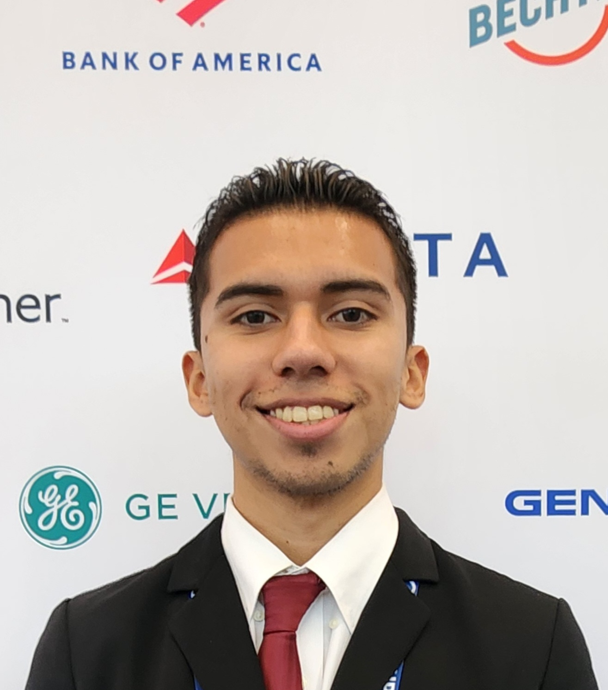

  

<h1 align="center">Hi there, I'm Marc Romero 👋</h1>

---

## 👨‍💻 About Me

I'm currently pursuing a Master of Engineering in Integrated Circuit Design at the University of California, Los Angeles (UCLA), after earning my B.S. in Computer Engineering with a concentration in Digital Hardware from UC Santa Cruz.

I'm passionate about digital hardware design, VLSI, and ASIC development, with a particular interest in designing efficient hardware accelerators and exploring how hardware and software work together. Through my coursework and hands-on projects, I've gained experience in RTL design, functional verification, and chip design workflows.

Beyond engineering, I've been actively involved in supporting underrepresented students in STEM through organizations like SHPE and MESA. I enjoy giving back to my community, mentoring others, and helping create opportunities for future engineers.

My goal is to become a Digital IC Design Engineer, contributing to innovative semiconductor technologies while continuing to learn, grow, and make a positive impact.

---

## 🔬 Featured Project: μTheia — Event-Based Vision ASIC

Technologies: SystemVerilog, Python, cocotb, GF180MCU, OpenROAD, LibreLane

μTheia is a custom ASIC developed as part of my senior VLSI capstone at UC Santa Cruz. Designed for event-based machine vision, the chip processes EVT2 event streams to extract spatiotemporal features and classify motion patterns using an SRAM-backed, integer MAC-based classifier.

Working alongside a team of five, I contributed to the RTL design and verification of the system, with a particular focus on gate-level simulation and timing verification using cocotb and SDF back-annotation.

This project gave me hands-on experience with the ASIC design flow, from hardware architecture and RTL implementation to physical design and post-layout verification.
🔗 [GitHub Repo](https://github.com/MarcRomero16/microTheia)

---

## 🛠 Tech Stack

### 💻 Programming & Hardware Description Languages

### 🔬 ASIC / VLSI Design & EDA

### 🧪 RTL Verification & Simulation

### ⚡ Hardware & Embedded Systems

### 🤖 Data Science & Machine Learning

### 🧰 Development Tools

<!-- Add or remove as needed -->

---

---

## 🚀 Key Projects

### 🔢 Tiny MatMul — 2×2 Systolic Matrix Multiplier

Designed a 2×2 systolic matrix multiplier in Verilog for the Tiny Tapeout platform, using multiply-and-accumulate operations to perform matrix multiplication across multiple clock cycles.

Implemented a controller to coordinate diagonal data flow through the systolic array, along with an 8-bit input interface and 16-bit output readback mechanism.

Developed cocotb testbenches to verify functionality through directed, randomized, reset, and edge-case testing.

🔗 [GitHub Repo](https://github.com/MarcRomero16/ttsky-mini-matmul)

### 🧠 Parkinson's Freezing of Gait Prediction — Michael J. Fox Foundation

Collaborated with a multidisciplinary team through Break Through Tech AI to develop machine learning models for detecting Freezing of Gait (FoG) in Parkinson's disease patients using wearable accelerometer data.

Contributed to exploratory data analysis, signal processing using Fast Fourier Transforms (FFT), feature engineering, and recurrent neural network (RNN) development to identify abnormal movement patterns.

Evaluated machine learning approaches, including Random Forest, RNN, and LSTM models. The RNN achieved approximately 92–93% accuracy and a 0.98 ROC-AUC, demonstrating the potential of wearable sensor data for gait monitoring.

🔗 [GitHub Repo](https://github.com/MarcRomero16/MJF-1A-Parkinson-s-Freezing-of-Gait-Prediction)

---

## 📬 Contact Me

- 📧 [marcromero2022@gmail.com](mailto:marcromero2022@gmail.com)
- 💼 [LinkedIn](https://www.linkedin.com/in/marc-romero2022/)

---

## 🏆 Awards & Certifications

- 📜 Dean's Honors List (2022-2026) – UCSC
- 🔖 Machine Learning Foundations Certificate – Cornell University

---
<!--
**MarcRomero16/MarcRomero16** is a ✨ _special_ ✨ repository because its `README.md` (this file) appears on your GitHub profile.

Here are some ideas to get you started:

- 🔭 I’m currently working on ...
- 🌱 I’m currently learning ...
- 👯 I’m looking to collaborate on ...
- 🤔 I’m looking for help with ...
- 💬 Ask me about ...
- 📫 How to reach me: ...
- 😄 Pronouns: ...
- ⚡ Fun fact: ...
-->
